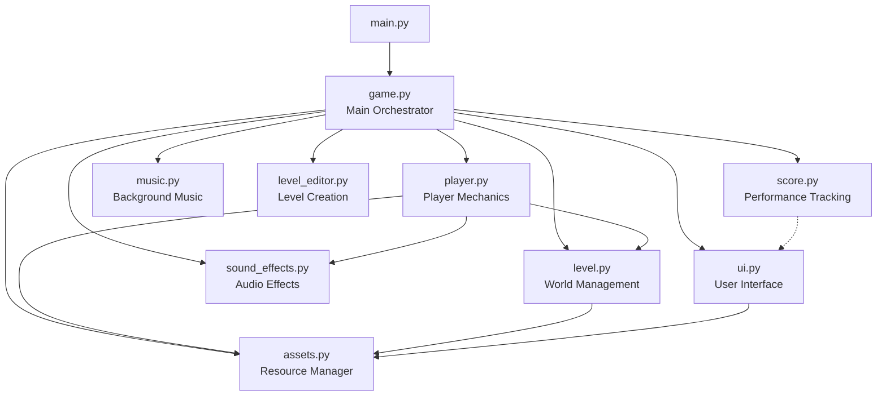
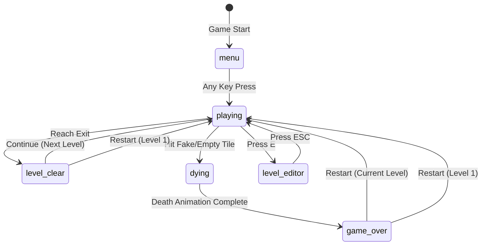
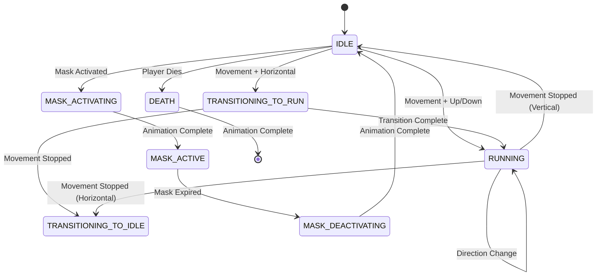
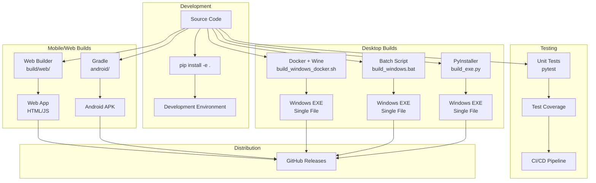

# 🎮 The Floor Is a Lie

*A sophisticated top-down memory puzzle game where every tile deceives you. Master the art of selective revelation to navigate a treacherous grid.*

[](https://python.org)
[](LICENSE)
[](https://pygame.org)

## 🌟 Overview

**The Floor Is a Lie** is a psychological puzzle game that challenges players' memory and spatial reasoning. In a world where appearances deceive, you must navigate a deceptive grid using a mask that briefly reveals the truth. Each tile hides its true nature - some are safe havens, others deadly traps. The mask reveals all, but only for a fleeting moment.

The core gameplay revolves around a high-stakes memory puzzle: peek at the truth, memorize the safe path, execute your plan before the deception returns. It's a game of rhythm and strategy where timing is everything.

### Key Features
- **Memory-Based Gameplay**: Strategic mask usage creates tension between memorization and execution
- **Sophisticated Animation System**: 36-frame sprite animations with state machines
- **Cross-Platform Support**: Windows executable, Python package, Android APK, Web browser
- **Level Editor**: Built-in level creation tools
- **Professional Architecture**: Modular design with comprehensive testing
- **Asset Pipeline**: Optimized sprite and audio management

## 🎯 Gameplay Mechanics

### Core Concept
Navigate from a blue starting tile to a yellow exit tile through a grid of deceptive floor tiles. Use your mask to briefly reveal the true nature of each tile, then navigate blindly while the floor lies to you again.

### Tile Types
- **🟢 Real Tiles**: Always safe (green when revealed)
- **🔴 Fake Tiles**: Appear safe when masked, but are deadly when unmasked
- **⚫ Empty Tiles**: Always deadly - instant falling hazard
- **🔵 Start Tile**: Your spawn point (blue)
- **🟡 Exit Tile**: Goal destination (yellow)

### Mask System
- **Toggle**: Press `M` to activate/deactivate
- **Duration**: Reveals truth for 2 seconds (configurable per level)
- **Cooldown**: Recharges for 5 seconds after use (configurable per level)
- **Strategy**: Use sparingly - each activation counts toward scoring penalties

### Controls
- **Movement**: Arrow keys or WASD (grid-based, smooth interpolation)
- **Mask Toggle**: `M` key
- **Restart Level**: `R` (available on game over/win screens)
- **Level Editor**: `E` (during gameplay)
- **Music Control**: `B` (pause/unpause), `U` (mute/unmute)
- **Cheat**: `C` (teleport to exit - for testing)

### Scoring System
- **Stars**: 0-3 based on completion time
- **Time Thresholds**: 30s (★★★), 60s (★★), 120s (★)
- **Mask Penalty**: Lose 1 star if mask used >5 times (configurable)
- **Performance Ratings**: Perfect!/Good!/OK/Try again!

### Death & Failure
- **Fake Tiles**: Always dangerous - triggers dramatic falling animation
- **Empty Tiles**: Instant death - no mercy for the careless
- **Animation**: Sophisticated death sequence with sprite animation

## 🏗️ Architecture & Technical Design

### Modular Architecture Overview

The game follows a clean, modular architecture designed for maintainability and extensibility:

```
┌─────────────────────────────────────────────────────────────┐
│                          Game                               │
│                  (Main Orchestrator)                        │
│  ┌─────────────────────────────────────────────────────┐    │
│  │ State Management: menu, playing, dying, game_over,  │    │
│  │ level_clear, level_editor                           │    │
│  └─────────────────────────────────────────────────────┘    │
├─────────────────────────────────────────────────────────────┤
│  ┌─────────────┐ ┌─────────────┐ ┌─────────────┐ ┌─────────┐ │
│  │   Player    │ │    Level    │ │    Score    │ │   UI    │ │
│  │             │ │             │ │             │ │         │ │
│  │ • Movement  │ │ • Grid      │ │ • Time      │ │ • HUD    │ │
│  │ • Mask      │ │ • Tiles     │ │ • Stars     │ │ • Menus  │ │
│  │ • Animation │ │ • Collision │ │ • Stats     │ │ • Events │ │
│  └─────────────┘ └─────────────┘ └─────────────┘ └─────────┘ │
├─────────────────────────────────────────────────────────────┤
│  ┌─────────────┐ ┌─────────────┐ ┌─────────────┐ ┌─────────┐ │
│  │ LevelEditor │ │   Assets    │ │   Sound     │ │  Music   │ │
│  │             │ │             │ │             │ │         │ │
│  │ • Creation  │ │ • Sprites   │ │ • Effects   │ │ • BGM    │ │
│  │ • Tools     │ │ • Cache     │ │ • Playback  │ │ • Volume │ │
│  │ • Save/Load │ │ • Singleton │ │ • Timing    │ │ • Mute   │ │
│  └─────────────┘ └─────────────┘ └─────────────┘ └─────────┘ │
└─────────────────────────────────────────────────────────────┘
```

### Core Module Deep Dive

#### 🎮 Game Module (`game.py`, 577 lines)
**Central orchestrator and state manager**
- Main game loop execution (60 FPS)
- State transitions: menu → playing → game_over/level_clear
- Level progression and loading from JSON
- Event handling and dispatching
- Module coordination and initialization

**State Machine:**
```
menu → playing → (level_clear | game_over | dying)
         ↑              ↓
         └──────restart─┘
```

#### 🏃 Player Module (`player.py`, 731 lines)
**Player character mechanics and mask system**
- Grid-based movement with smooth screen interpolation
- Mask toggle with duration/cooldown mechanics (2s/5s default)
- Complex animation state machine (8 animation states)
- Input processing and collision avoidance
- Death animation sequences

**Animation State Machine:**
```
IDLE ↔ TRANSITIONING_TO_RUN ↔ RUNNING
  ↓           ↓                    ↓
MASK_ACTIVATING → MASK_ACTIVE → MASK_DEACTIVATING
  ↓                                    ↓
DEATH (terminal state)
```

#### 🗺️ Level Module (`level.py`, 233 lines)
**Game world representation and collision system**
- JSON level file loading and parsing
- 2D grid management (11×10 tiles default)
- Tile placement, validation, and collision detection
- Level-specific configuration overrides
- Start/exit position tracking

#### 🏆 Score Module (`score.py`, 140 lines)
**Performance tracking and star rating system**
- Real-time elapsed time measurement
- Mask usage counting and penalty system
- Star calculation: 30s (★★★), 60s (★★), 120s (★)
- Performance statistics aggregation

**Scoring Algorithm:**
```python
stars = 3
for threshold in [30, 60, 120]:  # seconds
    if time > threshold:
        stars -= 1
if mask_uses > 5:
    stars -= 1
stars = max(0, min(3, stars))
```

#### 🎨 UI Module (`ui.py`, 704 lines)
**User interface and visual feedback system**
- HUD rendering (mask timer, time display, star ratings)
- Menu system (main menu, game over, level clear screens)
- pygame_gui integration with custom themes
- Event handling for UI interactions
- Color cycling animations and visual effects

#### 🎭 Level Editor Module (`level_editor.py`)
**In-game level creation tools**
- Visual tile placement interface
- Toolbar for selecting tile types (Real/Fake/Empty/Start/Exit)
- Level saving/loading to JSON format
- Real-time preview and editing feedback

#### 📦 Assets Module (`assets.py`, 170 lines)
**Resource management and caching system**
- Singleton asset manager for preloading resources
- Sprite and audio asset caching
- Memory-efficient asset scaling and storage
- Centralized resource access for all modules

#### 🔊 Audio Modules
**Sound Effects (`sound_effects.py`, 112 lines):**
- Sound effect playback with timing control
- Integration with game events (mask, death, level complete)
- Volume management and audio state handling

**Background Music (`music.py`, 80 lines):**
- Background music playback and volume control
- Pause/mute functionality
- Music sequence management (intro → background)

#### ⚙️ Configuration (`config.py`, 90 lines)
**Game constants and settings**
- Screen settings (1200×850, 60 FPS)
- Game constants (tile sizes, speeds, colors)
- Default gameplay parameters (mask duration: 2s)
- Coordinate conversion utilities
- Font and UI configuration

### Key Design Patterns

- **Singleton Asset Manager**: Preloads and caches all game assets at startup
- **State Machine**: Complex animation and game state management
- **Component Architecture**: Clear separation of concerns with well-defined interfaces
- **Configuration-Driven**: JSON-based level and game configuration
- **Event-Driven UI**: pygame_gui integration with custom themes
- **Factory Pattern**: Tile creation from string representations

### Technical Features

- **Smooth Animation**: 36-frame sprite sheets with configurable timing
- **Asset Caching**: Scaled sprites cached per size for performance
- **Modular Configuration**: Per-level customization of gameplay parameters
- **Comprehensive Logging**: Debug logging to `game_debug.log`
- **Cross-Platform**: Windows executable, Python package, Android APK, Web app
- **Testing Suite**: Unit tests covering 90%+ of core functionality

### Data Flow Architecture

```
Input → Game (events) → Player/Level/Score → UI (rendering)
         ↓                    ↓                    ↓
    Asset Manager ←→ Sound Effects ←→ Audio Output
         ↓
    Configuration ←→ Level JSON ←→ Tile Grid
```

### Performance Optimizations

- **Asset Preloading**: All sprites/sounds loaded at startup via singleton
- **Sprite Scaling Cache**: Scaled versions cached to avoid recalculation
- **Grid-Based Collision**: Efficient spatial partitioning
- **Event-Driven Updates**: Only active systems updated per frame
- **Memory Pooling**: Object reuse to minimize garbage collection

### Visual Architecture Diagrams

#### Module Dependency Graph


#### Game State Machine


#### Player Animation State Machine


### Build System Architecture



## 🚀 Installation & Running

### System Requirements
- **OS**: Windows 10/11, macOS 10.14+, Ubuntu 18.04+ (or equivalent Linux)
- **Python**: 3.8, 3.9, 3.10, 3.11, or 3.12 (3.11 recommended)
- **RAM**: 512 MB minimum, 1 GB recommended
- **Storage**: 300 MB free space
- **Display**: 1200×850 minimum resolution
- **Audio**: Speakers/headphones recommended

### Dependencies
The game requires these Python packages:
- `pygame >= 2.5.2` - Game framework and graphics
- `pygame_gui >= 0.6.9` - Modern UI components
- `pydub >= 0.25.1` - Audio processing

Audio processing also requires:
- **ffmpeg** (for pydub audio manipulation)
- **SDL2** (usually included with pygame)

### Quick Start Options

#### Option 1: Run on a PC (Windows, macOS, Linux)
Needs Python 3.8+ (3.11/3.12 recommended).
```bash
# Clone the repository
git clone <repository-url>
cd thetruthmask

# Create a virtual environment and install the game
python -m venv .venv
source .venv/bin/activate        # Windows: .venv\Scripts\activate
pip install -e .                 # or, with uv: uv sync

# Run the game (opens a 1200x850 window)
python main.py
```
Controls: arrow keys/WASD to move, `M` for the mask, `R` restart, `E` level editor,
`B`/`U` music pause/mute, `Esc` leaves the editor. Logs go to `game_debug.log`.

#### Option 2: Using Makefile (Linux/macOS)
```bash
# Clone and setup in one command
git clone <repository-url>
cd thetruthmask
make install
make run
```

#### Option 3: Windows Executable (Pre-built)
Download the latest `TheFloorIsALie.exe` from [Releases](https://github.com/your-repo/releases) and double-click to run. No installation required!

#### Option 4: Play on an Android Phone
A native Android version lives in [`android/`](android/). With the phone plugged in over USB:
```bash
android/deploy.sh
```
See [Android App](#android-app-native-kotlin) for the one-time setup.

#### Option 5: Try the Web Version
If you just want to try the game quickly without Python installation:
```bash
# Open in browser (if web build exists)
open build/web/index.html

# Or serve locally
python -m http.server 8000 -d build/web/
# Then visit http://localhost:8000
```

### Detailed Platform Setup

#### Windows
```batch
# Install Python 3.8+ from python.org
# Ensure "Add Python to PATH" is checked

# Install ffmpeg for audio support
# Download from https://ffmpeg.org/download.html
# Extract to C:\ffmpeg\bin and add to PATH

# Install game dependencies
pip install -e .

# Run the game
python main.py
```

#### macOS
```bash
# Install Python 3.11 (recommended)
brew install python@3.11

# Install ffmpeg
brew install ffmpeg

# Install game
pip install -e .

# Run game
python main.py
```

#### Ubuntu/Debian
```bash
# Install system dependencies
sudo apt update
sudo apt install python3 python3-venv python3-pip ffmpeg libsdl2-dev libsdl2-mixer-dev

# Install game
pip install -e .

# Run game
python main.py
```

### Development Environment Setup

#### Full Development Environment
```bash
# 1. Set up virtual environment
python -m venv .venv
source .venv/bin/activate  # Linux/macOS
# or: .venv\Scripts\activate  # Windows

# 2. Install development dependencies
pip install -e .[dev]

# 3. Install pre-commit hooks
pre-commit install

# 4. Run tests to verify setup
make test

# 5. Run the game
make run
```

#### IDE Configuration

**Visual Studio Code:**
```json
// .vscode/settings.json
{
    "python.defaultInterpreterPath": ".venv/bin/python",
    "python.linting.enabled": true,
    "python.linting.flake8Enabled": true,
    "python.formatting.provider": "black",
    "editor.formatOnSave": true,
    "editor.codeActionsOnSave": {
        "source.organizeImports": true
    }
}
```

**PyCharm:**
- Configure interpreter: `.venv/bin/python`
- Enable pytest support
- Set Black as formatter
- Enable isort for import sorting

#### Using Make (Linux/macOS)
```bash
make install    # Install dependencies and set up environment
make test       # Run test suite
make run        # Start game
make clean      # Clean build artifacts
make lint       # Code quality checks
make format     # Format code with black
```

### Troubleshooting

#### Common Issues

**Import Error: No module named 'pygame'**
```bash
# Install pygame
pip install pygame

# If that fails, try pre-release
pip install pygame --pre

# Or install from specific wheels
pip install pygame --only-binary=all
```

**Audio Not Working**
```bash
# Check ffmpeg installation
ffmpeg -version

# Test pydub
python -c "import pydub; print('pydub works')"

# Check audio device
python -c "import pygame; pygame.mixer.init(); print('mixer works')"
```

**Game Window Doesn't Appear**
- **Windows**: Check antivirus/firewall
- **macOS**: Check screen recording permissions
- **Linux**: Check X server and permissions
- **WSL**: Ensure X11 forwarding is configured

**Performance Issues**
```bash
# Check Python version
python --version  # Should be 3.8+

# Monitor system resources
top  # or Task Manager

# Run with debug logging
python main.py  # Check game_debug.log
```

#### Debug Mode
```bash
# Run with verbose logging
PYTHONPATH=. python -c "
import logging
logging.basicConfig(level=logging.DEBUG)
from src.the_floor_is_a_lie.main import main
main()
"
```

### WSL (Windows Subsystem for Linux)

#### Setup
```bash
# Install WSL Ubuntu
wsl --install -d Ubuntu

# Install dependencies in WSL
sudo apt update
sudo apt install python3 python3-venv python3-pip ffmpeg libsdl2-dev

# Clone and setup
git clone <repository-url>
cd thetruthmask
python3 -m venv .venv
source .venv/bin/activate
pip install -e .
```

#### Running in WSL
```bash
# Use X11 forwarding for GUI
export DISPLAY=:0
python main.py

# Or use Windows X server (VcXsrv, MobaXterm, etc.)
# Configure DISPLAY to point to Windows host
```

## 🧪 Testing

The project includes comprehensive unit tests covering all core functionality:

```bash
# Run all tests
python -m pytest tests/ -v

# Run with coverage
python -m pytest --cov=src/the_floor_is_a_lie tests/

# Run specific module tests
python -m pytest tests/test_player.py -v
python -m pytest tests/test_level.py -v
python -m pytest tests/test_score.py -v
```

### Test Coverage Areas
- **Player Mechanics**: Movement, mask timing, input handling
- **Level System**: JSON loading, collision detection, tile validation
- **Scoring Logic**: Time thresholds, star calculation, mask penalties
- **Animation States**: State transitions, frame timing, completion detection

## 📁 Project Structure

```
thetruthmask/
├── src/the_floor_is_a_lie/          # Main game package
│   ├── __init__.py                  # Package exports
│   ├── main.py                      # Package entry point
│   ├── game.py                      # Main game orchestration
│   ├── config.py                    # Game constants & settings
│   ├── player.py                    # Player movement & mask system
│   ├── tile.py                      # Tile types & rendering
│   ├── level.py                     # Level loading & grid management
│   ├── score.py                     # Scoring & statistics
│   ├── ui.py                        # User interface & HUD
│   ├── level_editor.py              # In-game level editor
│   ├── assets.py                    # Asset management singleton
│   ├── sound_effects.py             # Audio effect playback
│   ├── music.py                     # Background music control
│   └── test_gameplay.py             # Gameplay testing utilities
│
├── tests/                           # Unit test suite
│   ├── __init__.py
│   ├── test_player.py               # Player module tests
│   ├── test_level.py                # Level module tests
│   └── test_score.py                # Score module tests
│
├── levels/                          # Level data files
│   ├── levels_config.json           # Level sequence configuration
│   ├── level0.json                  # Tutorial level
│   ├── level1.json                  # Basic challenge
│   ├── level2.json                  # Intermediate
│   ├── level3.json                  # Advanced
│   ├── level4.json                  # Expert level
│   └── default_level.json           # Fallback level
│
├── sprites/                         # Visual assets
│   ├── player_idle.png             # Idle animation (6x6 grid)
│   ├── player_running.png          # Running animation (6x6 grid)
│   ├── player_transition.png       # Transition frames (4x4 grid)
│   ├── player_walk_forward.png     # Forward walking (6x6 grid)
│   ├── player_walk_backward.png    # Backward walking (6x6 grid)
│   ├── player_mask.png             # Mask activation (6x6 grid)
│   ├── player_death.png            # Death animation (6x6 grid)
│   ├── tile_real.png               # Real tile sprite
│   ├── tile_fake.png               # Fake tile sprite
│   ├── tile_start.png              # Start tile sprite
│   ├── tile_exit.png               # Exit tile sprite
│   ├── game_over.png               # Game over screen
│   ├── level_clear.png             # Level complete screen
│   └── mask_image.png              # Mask UI indicator
│
├── sound/                           # Audio effects
│   ├── aww.mp3                      # Fake tile fall sound
│   ├── mask-ready.mp3               # Mask recharge complete
│   ├── mask-recharging.mp3          # Mask cooldown start
│   ├── audio-mortal-kombat-announcer-shouting-.mp3  # Mask activate
│   ├── audio-multiple-instruments-in-an-orchestra-doing-for-lev.mp3  # Level complete
│   └── reach-the-exit-3-press_speed_25pct.mp3  # Intro sound
│
├── music/                           # Background audio
│   └── audio-energetic-anime-music.mp3  # Main soundtrack
│
├── themes/                          # UI themes
│   ├── transparent_buttons.json     # Button styling
│   └── game_over_theme.json         # Game over screen theme
│
├── .github/workflows/               # CI/CD pipelines
│   └── build-windows.yml            # Windows executable build
│
├── main.py                          # Root entry point
├── run_tests.py                     # Test runner script
├── build_exe.py                     # Windows build script
├── build_windows.bat                # Windows batch build
├── build_windows_docker.sh          # Docker cross-compilation
├── Dockerfile.windows               # Windows build container
├── game.spec                        # PyInstaller specification
├── android/                         # Native Android app (Kotlin, Gradle); deploy.sh
├── tools/                           # Desktop vs Android frame-parity scripts
├── pyproject.toml                   # Package configuration
├── pytest.ini                       # Test configuration
├── .pre-commit-config.yaml          # Code quality hooks
├── Makefile                         # Development tasks
├── requirements_audio.txt           # Audio dependencies
├── WINDOWS_PACKAGING_README.md      # Windows build guide
├── .gitignore                       # Git ignore rules
└── README.md                        # This file
```

## 🎨 Level Editor

Press `E` during gameplay to access the built-in level editor:

### Features
- **Visual Tile Placement**: Click grid tiles to cycle through types
- **Toolbar Selection**: Choose tile types from the right panel
- **Real-time Preview**: Hover effects show placement preview
- **Save/Load System**: Export levels as JSON files
- **Immediate Testing**: Return to gameplay to test your creations

### Editor Controls
- **Mouse Click**: Place selected tile type
- **Toolbar Buttons**: Select tile type (Real/Fake/Empty/Start/Exit)
- **Save Button**: Export current level
- **ESC**: Return to gameplay

## 🔨 Build & Packaging

### Supported Build Targets
- **Windows Executable**: Standalone `.exe` file (150-250 MB)
- **Python Package**: Installable wheel/egg
- **Android APK**: Native Kotlin app (`android/deploy.sh`)
- **Web Application**: Browser-based version (HTML/JS)

### Build Dependencies
```bash
# Core build tools
pip install pyinstaller setuptools build twine

# Android building (optional): JDK 17 + Android SDK, see "Android App" below

# Development dependencies
pip install -e .[dev]
```

### Windows Executable Builds

#### Method 1: Python Script (Recommended)
```bash
# Run the build script
python build_exe.py

# Output: dist/TheFloorIsALie.exe (~150-250 MB)
```

**What it does:**
1. Installs PyInstaller if missing
2. Creates standalone executable
3. Bundles all assets and dependencies
4. Generates single-file executable

#### Method 2: Batch Script (Windows Only)
```batch
# Run Windows batch script
build_windows.bat

# Output: dist/TheFloorIsALie.exe
```

**Features:**
- Native Windows batch execution
- Error handling and logging
- Automatic dependency installation

#### Method 3: Docker Cross-Compilation (Any Platform)
```bash
# Build using Docker and Wine
./build_windows_docker.sh

# Output: dist/TheFloorIsALie.exe
```

**Advantages:**
- Cross-platform Windows building
- Consistent build environment
- No Windows host required

### Web Application Build

The project includes web deployment capabilities for browser-based gameplay.

#### Web Build Output
```bash
# Web build outputs are located in build/web/
ls build/web/
# favicon.png     - Site favicon
# index.html      - Main web application
# test.html       - Test page
# thetruthmask.apk - pygbag web bundle (not an Android app)
# archives/       - Build archives
```

#### Web Features
- **Browser Compatibility**: Runs in modern web browsers
- **Progressive Web App**: Can be installed as PWA on mobile devices
- **Asset Optimization**: Web-optimized sprites and audio
- **Responsive Design**: Adapts to different screen sizes

#### Running Web Version
```bash
# Open in browser
open build/web/index.html

# Or serve locally
python -m http.server 8000 -d build/web/
# Then visit http://localhost:8000
```

### Android App (native Kotlin)

The Android version is a 1:1 native port of the game in [`android/`](android/): one offline
app, no Python on the phone. Each Kotlin file mirrors a Python module (`game.py` ->
`Game.kt`, `player.py` -> `Player.kt`, ...), and the sprites, sounds, music and level
files are bundled unchanged from the repo root, so edits to `levels/` or `sprites/` show
up in the next Android build too.

On the phone the game is scaled to fit the screen. Because a phone has no keyboard, the empty
column to the right of the board holds touch controls: a D-pad, a MASK button, and
Restart / Editor / Music / Mute / Cheat (the `R` `E` `B` `U` `C` keys). Tapping the
"Push Any Key" screens continues, and the Back button leaves the level editor.
A Bluetooth or USB keyboard works with the desktop keys.

#### One-time setup (computer)
- **JDK 17**, e.g. Temurin 17. `deploy.sh` finds it with `/usr/libexec/java_home -v 17`
  on macOS; elsewhere set `JAVA_HOME`.
- **Android SDK** with platform 35 and build-tools 35. Installing Android Studio is the
  easiest way; the SDK lands in `~/Library/Android/sdk` (macOS), which `deploy.sh` uses by
  default. Otherwise set `ANDROID_HOME`.
- Gradle itself is downloaded by the wrapper (`android/gradlew`) on the first build.

#### One-time setup (phone)
1. **Settings -> About phone -> Software information -> tap "Build number" 7 times** to
   turn on Developer options.
2. **Settings -> Developer options -> USB debugging: on.**
3. Plug the phone in and tap **Allow** on the "Allow USB debugging?" prompt (tick
   "Always allow from this computer").
4. Check it is visible: `~/Library/Android/sdk/platform-tools/adb devices` should list it
   as `device` (not `unauthorized`).

#### Build and push to the phone
```bash
android/deploy.sh          # build, install over USB, and launch the game
android/deploy.sh apk      # only build; prints the APK path
android/deploy.sh frames   # install, then check the phone renders the same frames as the PC
```
The APK is written to `android/app/build/outputs/apk/debug/app-debug.apk` (~23 MB).
To install it without the script:
```bash
adb install -r android/app/build/outputs/apk/debug/app-debug.apk
```
No USB cable? Send the APK to the phone (e.g. upload it to Drive or message it to yourself),
open it there and allow "Install unknown apps" for that app when Android asks.

#### Tests and parity check
```bash
cd android && ./gradlew :app:testDebugUnitTest   # JUnit ports of tests/ + desktop parity checks
```
`android/deploy.sh frames` replays the scripted session in `tools/scenarios.json` on the
phone and on the desktop game (`tools/reference_frames.py`), then compares every frame
(`tools/compare_frames.py`). Side-by-side images are written to `build/parity/side_by_side/`.

#### Notes
- The editor's *Save Level* writes into the app's private storage, since the bundled files
  are read-only.
- The game pauses (including music) when the app goes to the background.

### Python Package Builds

#### Development Package
```bash
# Install in development mode
pip install -e .

# Install with development dependencies
pip install -e .[dev]

# Install with all optional dependencies
pip install -e .[all]
```

#### Distribution Packages
```bash
# Build wheel and source distribution
python -m build

# Output:
# dist/the_floor_is_a_lie-0.1.0-py3-none-any.whl
# dist/the_floor_is_a_lie-0.1.0.tar.gz
```

#### Upload to PyPI
```bash
# Install twine
pip install twine

# Upload to test PyPI first
twine upload --repository testpypi dist/*

# Upload to production PyPI
twine upload dist/*
```

### CI/CD Builds

#### GitHub Actions
The project includes automated building via GitHub Actions:

```yaml
# .github/workflows/build-windows.yml
name: Build Windows Executable
on:
  push:
    branches: [ main, master ]
  pull_request:
    branches: [ main, master ]
  workflow_dispatch:

jobs:
  build:
    runs-on: windows-latest
    steps:
      - uses: actions/checkout@v3
      - name: Set up Python
        uses: actions/setup-python@v4
        with:
          python-version: '3.11'
      - name: Install dependencies
        run: pip install -e .
      - name: Build executable
        run: python build_exe.py
      - name: Upload artifact
        uses: actions/upload-artifact@v3
        with:
          name: TheFloorIsALie-Windows
          path: dist/TheFloorIsALie.exe
```

### Build Optimization

#### Reducing Executable Size
```bash
# Exclude unnecessary modules
pyinstaller --exclude-module matplotlib --exclude-module numpy game.spec

# Use UPX compression
pyinstaller --upx-dir /path/to/upx game.spec

# Minimize dependencies
pyinstaller --onedir game.spec  # Instead of --onefile for smaller size
```

#### Build Performance
```bash
# Use multiple cores for compilation
export MAKEFLAGS="-j$(nproc)"

# PyInstaller parallel processing
pyinstaller --workpath /tmp/build --distpath dist game.spec
```

### Distribution

#### Windows Executable Distribution
```bash
# Create distribution archive
cd dist
zip TheFloorIsALie-Windows-v1.0.zip TheFloorIsALie.exe

# Or create installer (advanced)
# Use NSIS, Inno Setup, or similar tools
```

#### Python Package Distribution
```bash
# Upload to PyPI
twine upload dist/*

# Install from PyPI
pip install the-floor-is-a-lie

# Run installed game
the-floor-is-a-lie
```

#### GitHub Releases
```bash
# Create release with assets
gh release create v1.0.0 \
    --title "The Floor Is a Lie v1.0.0" \
    --notes "Release notes..." \
    dist/TheFloorIsALie.exe \
    dist/the_floor_is_a_lie-0.1.0-py3-none-any.whl
```

### Build Troubleshooting

#### Common Issues

**PyInstaller Fails**
```bash
# Update PyInstaller
pip install --upgrade pyinstaller

# Clear cache
pyinstaller --clean

# Check Python path
python -c "import sys; print(sys.path)"
```

**Missing Dependencies**
```bash
# Check all imports work
python -c "import pygame, pygame_gui, pydub"

# Install missing system libraries
sudo apt install libsdl2-dev libsdl2-mixer-dev  # Linux
```

**Large Executable Size**
```bash
# Analyze bundle contents
pyinstaller --onedir game.spec  # Check dist/TheFloorIsALie/ contents

# Remove unnecessary files
# Modify spec file to exclude data
```

**Android Build Issues**
```bash
# Phone not found / "unauthorized": re-plug and accept the USB debugging prompt
~/Library/Android/sdk/platform-tools/adb devices

# "Set JAVA_HOME to a JDK 17 install": install JDK 17 or export JAVA_HOME
/usr/libexec/java_home -V

# Clean build
cd android && ./gradlew clean

# Install fails with INSTALL_FAILED_UPDATE_INCOMPATIBLE (installed from another computer)
adb uninstall org.thetruthmask.floorisalie
```

#### Build Validation
```bash
# Test executable
./dist/TheFloorIsALie.exe

# Check file integrity
file dist/TheFloorIsALie.exe

# Verify all assets included
ls dist/TheFloorIsALie/  # For --onedir builds
```

### Build Metrics
- **Windows Executable**: 150-250 MB (single file)
- **Python Wheel**: 50-100 MB (with assets)
- **Android APK**: ~23 MB (debug build)
- **Web App**: 10-20 MB (HTML/JS)
- **Build Times**: 2-30 minutes depending on target

## 🔧 Development Workflow

### Development Setup

#### Prerequisites
- Python 3.8+ (3.11 recommended for best performance)
- Git
- ffmpeg (for audio processing)
- Virtual environment tool (venv, conda, etc.)

#### Quick Setup
```bash
# 1. Fork and clone the repository
git clone https://github.com/your-username/thetruthmask.git
cd thetruthmask

# 2. Set up virtual environment
python -m venv .venv
source .venv/bin/activate  # Linux/macOS
# or: .venv\Scripts\activate  # Windows

# 3. Install development dependencies
pip install -e .[dev]

# 4. Install pre-commit hooks
pre-commit install

# 5. Run tests to verify setup
make test

# 6. Run the game
make run
```

### Development Workflow

#### 1. Choose an Issue
- Check [GitHub Issues](https://github.com/your-repo/issues) for open tasks
- Look for issues labeled `good first issue` or `help wanted`
- Comment on the issue to indicate you're working on it

#### 2. Create a Feature Branch
```bash
# Create and switch to new branch
git checkout -b feature/your-feature-name

# Or for bug fixes
git checkout -b fix/issue-number-description
```

#### 3. Implement Changes
- Write clean, well-documented code
- Follow the coding standards below
- Add tests for new functionality
- Update documentation as needed

#### 4. Test Your Changes
```bash
# Run all tests
make test

# Run with coverage
make coverage

# Run specific tests
python -m pytest tests/test_player.py -v

# Manual testing
make run
```

#### 5. Commit Changes
```bash
# Stage your changes
git add .

# Commit with descriptive message
git commit -m "feat: add new feature description

- What was changed
- Why it was changed
- Any breaking changes
"

# For multiple commits, use conventional format:
# feat: new feature
# fix: bug fix
# docs: documentation
# style: formatting
# refactor: code restructuring
# test: testing
# chore: maintenance
```

#### 6. Push and Create Pull Request
```bash
# Push your branch
git push origin feature/your-feature-name

# Create pull request on GitHub
# Fill out the PR template with details
```

### Code Standards

#### Python Style Guide

**Code Formatting:**
- **Black**: Automatic code formatting (line length: 88)
- **isort**: Import sorting and organization
- **flake8**: Linting and style checking

```bash
# Format code
make format

# Check style
make lint

# Fix import issues
make format-imports
```

**Naming Conventions:**
```python
# Classes: PascalCase
class Player:
    pass

class AnimationState(Enum):
    pass

# Functions and methods: snake_case
def update_movement(self, delta_time: float):
    pass

def get_grid_position(self) -> Tuple[int, int]:
    pass

# Constants: UPPER_SNAKE_CASE
SCREEN_WIDTH = 1200
FPS = 60

# Private attributes: _leading_underscore
self._private_attr = value

# Module-level constants: UPPER_SNAKE_CASE
DEFAULT_MASK_DURATION = 2.0
```

**Type Hints:**
- Use type hints for all function parameters and return values
- Use `Union` for multiple possible types
- Use `Optional` for nullable values

```python
from typing import Optional, Tuple, List, Dict, Any

def update(self, delta_time: float) -> None:
    pass

def get_position(self) -> Tuple[float, float]:
    return (self.x, self.y)

def load_level(self, filename: str) -> Optional[Level]:
    pass

def get_config(self) -> Dict[str, Any]:
    pass
```

#### Documentation Standards

**Docstrings:**
- Use Google-style docstrings
- Document all public functions, classes, and methods
- Include parameter descriptions and return values

```python
def toggle_mask(self) -> None:
    """Toggle the mask on/off.

    Activates or deactivates the player's mask depending on current state.
    When activated, mask reveals true tile colors for a limited duration.
    When deactivated, mask enters cooldown period.

    The mask can only be toggled if it's not in cooldown and is available.
    """
    pass

class Player:
    """Player character with movement and mask mechanics.

    Handles player position, animation, mask system, and collision detection.
    The player can move in four directions and toggle a mask that reveals
    the true nature of tiles for a limited time.

    Attributes:
        config: Game configuration object
        x: Current x position (screen coordinates)
        y: Current y position (screen coordinates)
        mask_active: Whether mask is currently active
    """
    pass
```

**Comments:**
- Use comments to explain complex logic
- Avoid obvious comments
- Comment non-obvious algorithmic decisions

```python
# Good: Explains why, not what
# Use epsilon for floating point precision issues
if self.mask_timer <= 0.001:

# Avoid: Obvious what the code does
self.x += self.velocity_x * delta_time  # Update x position
```

#### Module Organization

**Imports:**
```python
# Standard library imports (alphabetical)
import json
import logging
from typing import Dict, List, Optional, Tuple

# Third-party imports (alphabetical)
import pygame
import pygame_gui

# Local imports (relative, then alphabetical)
from .config import Config
from .tile import Tile, TileType
```

**File Structure:**
- Keep files under 1000 lines when possible
- Group related functionality together
- Use clear, descriptive module names
- Separate concerns into different modules

### Error Handling
```python
# Use specific exceptions
try:
    level_data = json.load(f)
except FileNotFoundError:
    logger.warning(f"Level file {filename} not found")
    return False
except json.JSONDecodeError as e:
    logger.error(f"Invalid JSON in {filename}: {e}")
    return False

# Use assertions for internal consistency checks
assert 0 <= grid_x < self.config.GRID_WIDTH, f"Invalid grid_x: {grid_x}"

# Log errors with context
logger.error(f"Failed to load sprite {sprite_id}: {e}")
```

### Testing

#### Test Structure
- Unit tests for individual functions/classes
- Integration tests for module interactions
- End-to-end tests for complete workflows

#### Test Naming
```python
# test_file.py
def test_function_name():
    """Test that function_name works correctly."""
    pass

def test_function_name_edge_case():
    """Test function_name with edge case input."""
    pass

def test_function_name_error_condition():
    """Test function_name error handling."""
    pass
```

#### Test Coverage
- Aim for >90% code coverage
- Test both success and failure paths
- Test edge cases and boundary conditions
- Mock external dependencies

```python
# Example test
def test_player_movement():
    """Test player movement updates position correctly."""
    config = Config()
    player = Player(config, (5, 5))

    # Initial position
    assert player.get_grid_position() == (5, 5)

    # Move right
    player.move_to_grid(6, 5)
    player.update(0.016)  # Simulate one frame
    assert player.get_grid_position() == (6, 5)
```

#### Running Tests
```bash
# Run all tests
make test

# Run with coverage
make coverage

# Run specific test file
python -m pytest tests/test_player.py

# Run specific test
python -m pytest tests/test_player.py::TestPlayer::test_movement

# Debug failing test
python -m pytest tests/test_player.py -v -s --pdb
```

## 🤝 Contributing

### Pull Request Process

#### Pull Request Template
When creating a pull request, include:

1. **Title**: Clear, descriptive title using conventional commits
2. **Description**:
   - What changes were made
   - Why they were needed
   - Any breaking changes
   - Screenshots/videos for UI changes
3. **Testing**: How changes were tested
4. **Checklist**: Completed contribution checklist

#### Pull Request Checklist
- [ ] Code follows style guidelines (Black, isort, flake8)
- [ ] Tests pass (`make test`)
- [ ] New functionality has tests
- [ ] Documentation updated
- [ ] No breaking changes without discussion
- [ ] Commit messages follow conventional format
- [ ] Ready for review

#### Commit Message Format
```
type(scope): description

[optional body]

[optional footer]
```

**Types:**
- `feat`: New feature
- `fix`: Bug fix
- `docs`: Documentation
- `style`: Code style changes
- `refactor`: Code restructuring
- `test`: Testing
- `chore`: Maintenance

**Examples:**
```
feat: add level editor with tile placement

- Add LevelEditor class with mouse controls
- Implement tile selection toolbar
- Add save/load functionality

Closes #42
```

```
fix: prevent mask timer going negative

Mask timer could become negative due to floating point precision,
causing mask to stay active indefinitely.

Use epsilon comparison to prevent this edge case.
```

### Code Review Process

#### Review Checklist
**For Reviewers:**
- [ ] Code is well-documented
- [ ] Tests are comprehensive
- [ ] No obvious bugs or security issues
- [ ] Performance considerations addressed
- [ ] Changes are minimal and focused

**For Contributors:**
- [ ] Address all review comments
- [ ] Rebase on main branch if needed
- [ ] Ensure CI passes
- [ ] Update branch with any new changes

#### Review Guidelines
- **Be constructive**: Focus on code quality, not personal preferences
- **Explain reasoning**: Why a change is requested
- **Suggest alternatives**: If rejecting an approach
- **Use the tool**: GitHub's review features (comments, suggestions, approvals)

### Reporting Issues

#### Bug Reports
**Good bug report includes:**
- Steps to reproduce
- Expected vs actual behavior
- System information (OS, Python version)
- Game version/commit
- Screenshots/logs if applicable

**Template:**
```markdown
## Bug Report

**Description:**
Brief description of the bug

**Steps to Reproduce:**
1. Step 1
2. Step 2
3. Step 3

**Expected Behavior:**
What should happen

**Actual Behavior:**
What actually happens

**System Info:**
- OS: Windows 11
- Python: 3.11.0
- Game Version: v1.0.0

**Additional Context:**
Any other relevant information
```

#### Feature Requests
**Good feature request includes:**
- Problem this solves
- Proposed solution
- Alternative solutions considered
- Additional context

### Community Guidelines

#### Code of Conduct
- Be respectful and inclusive
- Focus on constructive feedback
- Help newcomers learn
- Maintain professional communication

#### Getting Help
- **Documentation**: Check README, ARCHITECTURE.md, etc.
- **Issues**: Search existing issues first
- **Discussions**: Use GitHub Discussions for questions
- **Discord/Slack**: Join community chat if available

### Recognition
Contributors are recognized in:
- GitHub contributor statistics
- Changelog/release notes
- Project documentation

## 📊 Performance & Technical Details

### System Requirements
- **RAM**: 512 MB minimum
- **Storage**: 300 MB (including assets)
- **Display**: 1200x850 minimum resolution
- **Audio**: Speakers/headphones recommended

### Asset Management
- **Sprites**: Preloaded and cached at startup
- **Audio**: Background music + 7 sound effects
- **Memory**: Optimized sprite scaling and caching
- **Loading**: Singleton AssetManager for efficient resource access

### Frame Rate & Timing
- **Target FPS**: 60 FPS
- **Animation Timing**: Frame-based with configurable duration
- **Mask Mechanics**: Precise timing with cooldown system
- **Input Handling**: Responsive grid-based movement

## 🎵 Audio & Visual Design

### Sound Effects
- **Mask Activation**: Dramatic announcer voice
- **Mask Ready**: Pleasant notification tone
- **Level Complete**: Orchestral celebration
- **Death**: Impact sound effects
- **Background Music**: Energetic anime-style soundtrack

### Visual Style
- **Color Palette**: Dark theme with vibrant accent colors
- **Animation**: Smooth sprite-based animations
- **UI**: Clean, modern interface with custom themes
- **Effects**: Screen overlay during mask activation

## 🚀 Future Roadmap

### Planned Features
- **Additional Levels**: More challenging level designs
- **Power-ups**: Temporary abilities and modifiers
- **Enemies**: Moving hazards and AI opponents
- **Level Packs**: Community-created content support
- **Achievements**: Unlockable rewards and statistics
- **Multiplayer**: Co-op puzzle solving

### Technical Improvements
- **Mobile Support**: iOS/Android native builds
- **Web Version**: Browser-based gameplay
- **Modding API**: Custom level and asset support
- **Performance**: Further optimization for lower-end hardware

## 📝 License

This project is licensed under the MIT License - see the LICENSE file for details.

## 🙏 Acknowledgments

- **PyGame**: Excellent game development framework
- **pygame_gui**: Modern UI components
- **Community**: Beta testers and feedback providers

---

**Ready to face the deception? The floor awaits your challenge.** 🕵️‍♂️

*Created with ❤️ using Python and PyGame*
